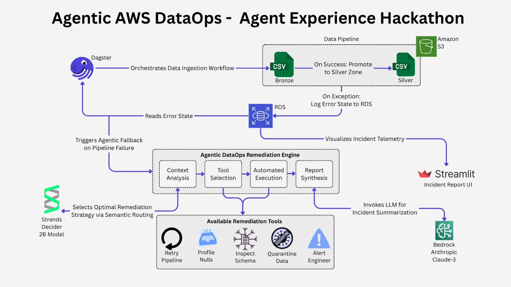
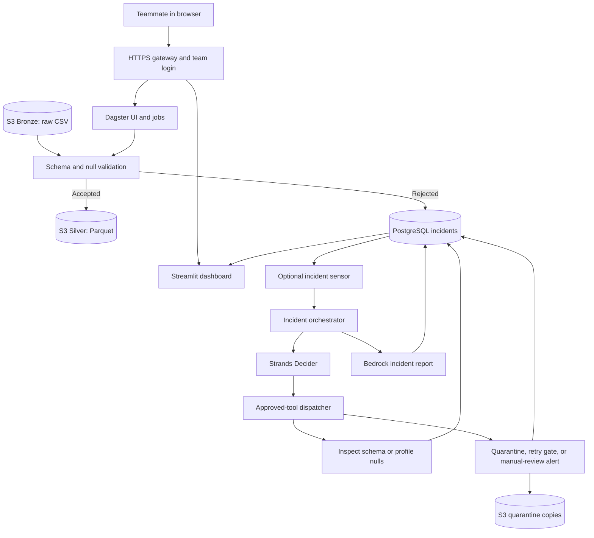

# Agentic AWS DataOps — Project Ulo

A data-quality and incident-management project built with Python, Dagster, Amazon
S3, PostgreSQL, Strands Decider, Amazon Bedrock, and Streamlit.

The pipeline reads order CSVs from S3, validates them, and writes accepted batches
as Parquet. Rejected batches become incidents with evidence for the team to review.
An optional AI-assisted workflow selects approved investigation/remediation tools
and generates incident reports.

## Contents

- [Project overview](#project-overview)
- [Architecture and data flow](#architecture-and-data-flow)
- [Implemented components](#implemented-components)
- [Try the shared demo](#try-the-shared-demo)
- [Order schema and validation rules](#order-schema-and-validation-rules)
- [Repository structure](#repository-structure)
- [Clone and install](#clone-and-install)
- [Local PostgreSQL and LocalStack setup](#local-postgresql-and-localstack-setup)
- [Local apps with real AWS resources](#local-apps-with-real-aws-resources)
- [Configuration reference](#configuration-reference)
- [Testing](#testing)
- [AI diagnosis and incident review](#ai-diagnosis-and-incident-review)
- [AWS deployment and maintenance](#aws-deployment-and-maintenance)
- [Team contribution workflow](#team-contribution-workflow)
- [Memory, costs, and limitations](#memory-costs-and-limitations)
- [Troubleshooting](#troubleshooting)
- [Further documentation](#further-documentation)

## Project overview

Imagine an online shop sending order files every day. A new file might contain
missing columns, invalid amounts, bad dates, or too many empty values. Passing
those errors into reporting would make downstream results unreliable.

This project provides a controlled path from raw data to usable data:

1. Keep the original CSV in S3 **Bronze**, the raw-data area.
2. Run a Dagster job against that file.
3. Check its schema, values, and null percentages.
4. Write an accepted batch to S3 **Silver** as Parquet.
5. Record an incident in PostgreSQL when validation fails.
6. Optionally investigate the incident with approved tools selected by the Decider.
7. Let a human review the evidence, report, and incident status.

For a class presentation:

> We built a system that checks incoming order data before it reaches analytics.
> Good files become Parquet datasets in S3. Bad files create traceable incidents.
> An AI decision model can choose from a small set of investigation and remediation
> tools, while Dagster and a dashboard let our team monitor runs and make review
> decisions.

The validator rejects an entire broken batch. It does not silently remove bad
rows, fill missing values, or overwrite the original file.

## Architecture and data flow





The hosted installation runs Dagster's webserver and daemon, Streamlit, and the
Decider on one EC2 instance. S3 stores datasets; RDS PostgreSQL stores incidents.
Dagster history, model files, and worker intermediates live on the encrypted EC2
disk. Caddy provides HTTPS/authentication; Systems Manager provides server access
without an inbound SSH port.

Data-quality validation is deterministic. It does not ask an LLM whether a row is
valid. AI is used after a failure to choose investigation/remediation actions and
help explain the incident.

## Implemented components

| Area | Current behavior |
| --- | --- |
| Ingestion | Read a selected S3 CSV with `orders_data_quality_job` |
| Validation | Check schema, compatible types, invalid values, per-column null ratios, and unreadable CSVs |
| Accepted output | Preserve accepted rows in a new Silver Parquet object |
| Rejected output | Fail the Dagster run and create an incident |
| Incident tracking | Persist run/source IDs, evidence, status, decisions, confidence, results, and reports |
| Decider | Use a CLI model or an external HTTP decision service |
| Dispatch | Validate every action against a fixed tool allowlist |
| Quarantine | Implement an S3 copy that preserves the original Bronze object |
| Retry | Check retry limits and prepare rerun configuration; actual relaunch is not implemented |
| Reporting | Generate a Bedrock incident report with fallback handling |
| Dashboard | Filters, evidence, decisions, reports, and manual review controls |
| Team hosting | Protected public URLs, queued jobs, and a source-update command |

Hosted verification covered ingestion/rejection, incident persistence, dashboard
rendering, authentication, source updates, and a Decider decision. The remediation
sensor starts stopped and SNS email delivery is disabled. Read the
[limitations](#memory-costs-and-limitations) before enabling other paths or treating
this demo as a production service.

## Try the shared demo

### Run a clean batch

1. Open the [team home](https://44.196.49.100.sslip.io/) and enter the team login.
2. In Dagster, open **Jobs → orders_data_quality_job → Launchpad**.
3. Paste the following configuration and click **Launch Run**:

```yaml
ops:
  bronze_orders:
    config:
      source_key: bronze/orders.csv
  silver_orders:
    config:
      source_key: bronze/orders.csv
```

Expect **SUCCESS**, a new Silver Parquet object, and no new data-quality incident
for that run. Inspect the run's logs and asset materializations. Configure both
assets with the same source to keep their validation and source lineage aligned.

### Run a broken batch

Replace both source keys with either:

```text
bronze/high_nulls.csv
bronze/unexpected_column.csv
```

Launch again. Expect **FAILURE** caused by validation. In the dashboard, click
**Refresh**, find the pending incident, and inspect its schema/null evidence.
Match its run ID to the failed Dagster run.

An expected rejection is a successful validator test. Manual review actions change
incident status; they do not repair the original CSV.

### Test the existing 1,100-row files

Use these keys in the same Launchpad configuration:

| Case | S3 key | Expected result |
| --- | --- | --- |
| Clean | `bronze/mixed-tests/20261018T205950Z-2afc5252/clean_large.csv` | SUCCESS and 1,100 Parquet rows |
| Broken | `bronze/mixed-tests/20261018T205950Z-2afc5252/late_invalid_amount.csv` | FAILURE and a schema-drift incident |

The broken file contains an invalid amount in data row 1,051. Validation checks
beyond the first 1,000 rows. Both files already exist in the team's S3 bucket;
using the browser does not download them to your PC.

Verified hosted runs:

- [Clean 1,100-row run](https://44.196.49.100.sslip.io/dagster/runs/2907456d-6615-4a9f-8b44-372f34f19634)
- [Expected broken-data failure](https://44.196.49.100.sslip.io/dagster/runs/9b1c6dd5-0787-4a71-8957-c1379b025b57)

Hosted outputs use `silver/shared-demo/`. Repeating a broken test adds another
incident with its own run ID. Teammates share incident state, so coordinate any
manual status changes.

## Order schema and validation rules

The default contract lives in
[`dataops_agent/tools/inspect_schema.py`](dataops_agent/tools/inspect_schema.py).

| Column | Expected type | Example |
| --- | --- | --- |
| `order_id` | Integer | `1001` |
| `customer_id` | Integer | `501` |
| `order_date` | Date | `2026-10-01` |
| `status` | String | `paid` |
| `amount` | Float-compatible numeric value | `129.95` |
| `currency` | String | `USD` |

```csv
order_id,customer_id,order_date,status,amount,currency
1001,501,2026-10-01,paid,129.95,USD
1002,502,2026-10-01,paid,74.50,USD
```

- Column order may change; missing or unexpected columns fail the default contract.
- Invalid amounts and unparseable dates are rejected.
- The default null limit is **15% per column**. Exactly 15% is allowed; more fails.
- Empty, headers-only, and malformed CSVs are rejected. Parsing failures create
  incidents when the incident database is available.
- Rejected batches produce no Silver output; accepted rows are preserved.

The contract does **not** currently enforce unique IDs, positive amounts, an
allowed-currency list, or an allowed-status list. Add explicit rules and tests
before relying on those business properties.

Asset configuration also supports `source_uri`, `target_schema`,
`max_null_percentage`, and `silver_key_prefix`. S3 access remains subject to the
worker's IAM permissions; the hosted role only writes inside its demo prefixes.

## Repository structure

```text
config/settings.py                 Validated settings and AWS client factories
dagster_project/assets.py           Bronze ingestion, validation, Silver output
dagster_project/jobs.py             Data-quality and incident-diagnosis jobs
dagster_project/sensors.py          Pending-incident polling sensor
dataops_agent/incident_state.py     PostgreSQL schema mapping and incident lifecycle
dataops_agent/decider_client.py     CLI/HTTP decisions and fallback behavior
dataops_agent/dispatcher.py         Approved-tool execution
dataops_agent/orchestrator.py       Investigation and remediation workflow
dataops_agent/bedrock_report.py     Bedrock reports
dataops_agent/tools/               Evidence and remediation tools
dashboard/app.py                   Streamlit monitoring and manual review
db/init/                          Database schema, indexes, timestamp trigger
deploy/aws/                       CloudFormation, bootstrap, services, gateway
localstack/init/                   Local S3 bucket and sample initialization
run_configs/                      Example Dagster run configuration
sample_data/                      Small synthetic fixtures and manifest
scripts/run.py                    Launch an app or one job
scripts/retest_s3_data.py          Reuse S3 inputs with in-memory assets
scripts/mixed_data_demo.py         Validation preview and optional live campaign
scripts/deploy_team.py            Package, deploy, update, inspect, stop/start
tests/                            Startup, validation, and packaging regressions
reports/                          Recorded verification results
docs/                             Testing, hosting, reference design
docker-compose.yml                Local PostgreSQL and LocalStack
.env.example                      Dummy local-development configuration
.env.aws.example                  Real-AWS template without passwords
workspace.yaml                    Dagster code-location definition
requirements.txt                  Application dependencies
```

The unrelated `friend-agentic-aws-dataops/` folder is not included in this project,
Git content, or deployment. Credentials, editor settings, virtual environments,
logs, and runtime storage are excluded. Small synthetic fixtures are intentionally
tracked so teammates can reproduce the validation cases.

## Clone and install

Browser-only users can skip this section. Local development uses your computer's
RAM and disk.

Prerequisites are Git, Python, and optionally Docker/AWS CLI for the selected
workflow. **Python 3.12 is recommended**; the application targets Python 3.11+,
and previous local testing also used Python 3.13. The Decider dependencies and
model need substantially more memory/disk than simply viewing the hosted app.

PowerShell:

```powershell
git clone https://github.com/ks-exe/project-Ulo.git
cd project-Ulo
python -m venv .venv
.\.venv\Scripts\Activate.ps1
python -m pip install --upgrade pip
python -m pip install torch==2.9.1 --index-url https://download.pytorch.org/whl/cpu
python -m pip install -r requirements.txt
python -m pip install pytest
```

On Linux/macOS, activate with `source .venv/bin/activate`; use `python3` to create
the environment where needed. If PowerShell activation is restricted, use
`.\.venv\Scripts\python.exe` instead of `python` without changing global policy.

The explicit PyTorch command selects CPU wheels. Developers intentionally using a
GPU should select a compatible build. The Decider downloads model weights on first
use; ordinary data-quality jobs do not invoke it. AWS bootstrap performs its model
download on the cloud server.

## Local PostgreSQL and LocalStack setup

This option runs the apps and emulates S3 on your machine, without connecting to
the shared incident database.

### Start services

```powershell
Copy-Item .env.example .env
docker compose up -d
docker compose ps
```

Copy the template when creating a new configuration; preserve an existing `.env`
if it contains values you need. Compose starts PostgreSQL on port 5432 and
LocalStack on port 4566. A new PostgreSQL volume runs `db/init/`; LocalStack uploads
the included clean, high-null, and unexpected-column examples to its local bucket.

For initialization problems, use `docker compose logs postgres localstack`.

### Start apps and run jobs

Use two terminals with the virtual environment active:

```powershell
python scripts/run.py dagster --env-file .env
```

```powershell
python scripts/run.py dashboard --env-file .env
```

Open <http://127.0.0.1:3000> and <http://127.0.0.1:8501>. These addresses are local
to your computer; use the public URLs above for teammate access.

```powershell
python scripts/run.py job --env-file .env
python scripts/run.py job --env-file .env --config run_configs/schema_drift_demo.yml
```

The first should succeed. The second intentionally fails validation and records an
incident. Keep the remediation sensor stopped unless you intend to run the model
on your machine. This Compose setup emulates S3, not Bedrock; unavailable local
report generation uses the application's fallback handling.

Stop containers with `docker compose stop`, or remove containers while keeping
volumes with `docker compose down`. Keep the volumes if you need local history.

## Local apps with real AWS resources

This option stores data/incidents in AWS but executes the local Python worker on
your PC. Use the hosted Dagster UI for all-cloud processing.

1. Authenticate your own approved AWS CLI profile and check its account:

   ```powershell
   aws sts get-caller-identity --profile default
   ```

2. Create a private environment file:

   ```powershell
   Copy-Item .env.aws.example .env.aws.local
   ```

3. Fill in authorized database credentials, bucket, region, and profile.
   URL-encode special characters in the database username/password. Leave the
   endpoint override empty; the AWS template clears emulator credentials.
4. Confirm RDS allows your intended network source. A changed local public IP may
   need an updated security-group rule from the maintainer. Browser users do not
   need direct RDS access.
5. Start both apps using the same private environment file:

   ```powershell
   python scripts/run.py dagster --env-file .env.aws.local
   python scripts/run.py dashboard --env-file .env.aws.local
   ```

The shared database is already initialized. For a new database, apply
[`db/init/001_create_dataops_incidents.sql`](db/init/001_create_dataops_incidents.sql)
with an authorized PostgreSQL client. Do not reinitialize the shared database as
part of routine teammate setup.

`scripts/write_real_aws_env.ps1` is a historical, account-specific helper that
writes a real secret into an ignored file. Review its hardcoded resource and
notification settings before use; the example-file workflow above is the starting
point for a new teammate. Never share the maintainer's AWS keys or private env file.

## Configuration reference

[`config/settings.py`](config/settings.py) validates configuration and centralizes
AWS clients. Environment paths resolve relative to the project.
`scripts/run.py --env-file ...` establishes `DATAOPS_ENV_FILE`, the Python import
path, and persistent Dagster storage, avoiding accidental local/AWS env mixing.

| Setting | Purpose / default |
| --- | --- |
| `DATABASE_URL` | Required PostgreSQL SQLAlchemy URL; normally `postgresql+psycopg://...` |
| `AWS_REGION` | Region; default `us-east-1` |
| `AWS_PROFILE` | Optional local CLI profile; EC2 services use the instance role |
| `AWS_ACCESS_KEY_ID`, `AWS_SECRET_ACCESS_KEY`, `AWS_SESSION_TOKEN` | Optional explicit credentials; use dummy keys only with LocalStack |
| `AWS_ENDPOINT_URL` | LocalStack override; empty for real AWS |
| `S3_BUCKET_NAME` | Required dataset bucket |
| `S3_BRONZE_PREFIX` | Raw inputs; default `bronze/` |
| `S3_SILVER_PREFIX` | Accepted output; default `silver/`, hosted `silver/shared-demo/` |
| `S3_QUARANTINE_PREFIX` | Copies; default `quarantine/`, hosted `quarantine/shared-demo/` |
| `MAX_NULL_PERCENTAGE` | Null ratio on a 0–1 scale; default `0.15` |
| `MAX_RETRY_COUNT` | Gate limit; code default 3, example files use 2 |
| `DECIDER_MODE` | `cli` or `http`; code default HTTP, supplied templates CLI |
| `STRANDS_DECIDER_MODEL_ID` | CLI model; `StrandsAgents/strands-decider-2B-hobson-v19` |
| `DECIDER_TIMEOUT_SECONDS` | Code/local example 240 seconds; hosted 600 seconds |
| `STRANDS_DECIDER_ENDPOINT` | HTTP service base URL; client calls `/v1/decide` |
| `STRANDS_DECIDER_API_KEY` | Required bearer credential in HTTP mode |
| `BEDROCK_MODEL_ID` | Templates/hosting use `amazon.nova-micro-v1:0`; model access is required |
| `ALERT_SNS_TOPIC_ARN` | Optional notification topic; empty disables publication |
| `DATAOPS_ENV_FILE` | Explicit application environment file |
| `DAGSTER_HOME` | Instance history/configuration; launcher default `.dagster_home/` |

Keep `.env`, `.env.aws.local`, AWS credentials, and `.deployment/team-access.txt`
out of Git. Example files contain placeholders or local dummy credentials only.

## Testing

### Automated regressions

```powershell
python -m pytest tests -q
```

The full verification on 2026-10-19 passed **24 tests** covering environment and
startup behavior, project discovery, mixed-data validation, unreadable-CSV incident
handling, dashboard startup, and deployment-package exclusions. The suite does not
call real AWS services. Existing Dagster deprecation warnings remain documented.

### Synthetic mixed-data preview

```powershell
python scripts/mixed_data_demo.py
```

There are 15 synthetic cases: five acceptable and ten broken. Cases cover column
reordering, missing/extra columns, null thresholds, bad amounts/dates, invalid data
past row 1,000, and CSV parsing failures. See the
[manifest](sample_data/mixed_cases/manifest.json) and
[fixture documentation](sample_data/mixed_cases/README.md).

### Reuse existing S3 inputs

From a configured development machine:

```powershell
python scripts/retest_s3_data.py --case clean
python scripts/retest_s3_data.py --case broken
python scripts/retest_s3_data.py --case both
```

The helper defaults to `.env.aws.local`, reads existing S3 CSVs, keeps asset
intermediates in memory, and verifies output/incidents. Successful outputs use a
unique `silver/manual-retests/` prefix. It still uses local RAM and stores run
metadata, but does not save CSV/DataFrame intermediates locally.
`PASS broken: FAILURE` means the expected rejection passed.

For no local worker processing, use the hosted UI instead. The
[manual S3 guide](docs/MANUAL_S3_TESTING.md) details this optional local helper.

### Optional live campaign

```powershell
python scripts/mixed_data_demo.py --live --env-file .env.aws.local
```

This deliberately uploads synthetic fixtures to a new S3 prefix, executes all
15 cases, creates incidents for failures, and saves reports. It is not needed to
reuse existing objects. The helper does not directly run remediation, but an
enabled sensor can subsequently process its incidents.

The recorded live campaign matched all 15 expectations. Hosted verification also
ran both 1,100-row cases and checked the clean Parquet contents directly on AWS.

## AI diagnosis and incident review

`incident_remediation_sensor` polls pending incidents and requests
`incident_diagnosis_job` runs when enabled. Workers claim an incident within a
transaction using `FOR UPDATE SKIP LOCKED`. Sensor run keys include the incident
ID and update timestamp.

The orchestrator obtains evidence/remediation decisions, validates the action,
dispatches approved tools, persists results, and attempts a report. Its allowlist is:

| Tool | Responsibility |
| --- | --- |
| `inspect_schema` | Compare columns/types with the expected contract |
| `profile_nulls` | Examine missing values and threshold breaches |
| `quarantine_batch` | Copy a Bronze object with incident metadata/tags; preserve Bronze |
| `retry_pipeline` | Check exhaustion and prepare a permitted rerun configuration |
| `alert_engineer` | Record a human-review payload; optionally publish to configured SNS |

Unavailable, malformed, or invalid decisions fall back to `alert_engineer` with
confidence 0. An empty SNS topic prevents email publication while retaining the
structured review result.

To enable the workflow, open **Automation** in Dagster and turn on
`incident_remediation_sensor`. It can process existing pending incidents in the
shared database, not just your latest test. Leave it off for validation-only demos.

The database records stages including `pending`, `investigating`,
`evidence_recorded`, `decision_recorded`, `action_succeeded`, and `action_failed`.
Final states include `completed`, `manual_review`, and `failed`.

The dashboard includes schema/null evidence, decisions, reports, and structured
results. Manual actions map as follows:

| Review action | Resulting status |
| --- | --- |
| `acknowledge` | `manual_review` |
| `mark_resolved` | `completed` |
| `escalate` | `failed` |

The operator note and timestamp accompany the action. Resolving an incident does
not repair data or automatically rerun a pipeline.

## AWS deployment and maintenance

See the detailed [team operations guide](docs/TEAM_DEPLOYMENT.md).

### Prerequisites and initial deployment

Hosting reuses an existing S3 bucket and RDS PostgreSQL database. It does not build
the whole data platform from an empty AWS account. Provide an initialized database
named `dataops`, an RDS-managed Secrets Manager credential, the input bucket/files,
a compatible VPC/subnet, and an AWS identity allowed to create the hosting resources.
The helper selects a public-IP-enabled subnet in the RDS VPC; that subnet needs
working internet connectivity. Bedrock reports also require model access.

Review [`deploy/aws/template.yaml`](deploy/aws/template.yaml), then validate:

```powershell
uvx --from cfn-lint cfn-lint deploy/aws/template.yaml --regions us-east-1
aws cloudformation validate-template --region us-east-1 --template-body file://deploy/aws/template.yaml
python scripts/deploy_team.py package
python scripts/deploy_team.py deploy --profile default
```

The default stack `agentic-dataops-team` in `us-east-1` already exists for this
project. Use `status` or `update` for it, not initial deployment again. For another
environment, pass `--stack`, `--bucket`, `--database`, `--region`, `--profile`, and
optionally `--instance-type`; also review account-specific example references.

The stack adds an EC2 server, encrypted 40 GB root disk, reserved IP, login secret,
server role, web security group, and RDS access scoped to that server group.
Bootstrap installs dependencies/model files on AWS, reads secrets, and starts:

```text
dataops-web         Dagster webserver
dataops-daemon      Sensors and queued run launcher
dataops-dashboard   Streamlit
caddy              HTTPS, login, reverse proxy
```

Stack completion precedes application readiness. Wait for bootstrap and certificate
issuance. The cloud Dagster configuration queues jobs one at a time.

### Links, login, and source updates

```powershell
python scripts/deploy_team.py status
python scripts/deploy_team.py login
```

`status` prints URLs/instance details. `login` saves credentials to ignored
`.deployment/team-access.txt`; share them privately with authorized teammates.

An AWS-authorized maintainer publishes a reviewed checkout with:

```powershell
git pull --ff-only origin main
python -m pytest tests -q
python scripts/deploy_team.py update --profile default
```

The update packages the current working tree's allowed source, uploads a private
S3 archive, and installs through Systems Manager. Review/commit local changes
first: packaging is not restricted to the last Git commit. The update checks for
active Dagster jobs, briefly restarts services, and retains the prior source release.

This updates application source, not CloudFormation infrastructure. IAM, networking,
instance sizing, and service-unit changes need a separate reviewed infrastructure
or host update. Dependencies share one Python environment, so a source symlink
rollback alone does not guarantee a dependency rollback.

**Pushing GitHub code does not automatically update the website.** There is no
GitHub Actions deployment pipeline in this repository at present.

### Stop/start and diagnostics

```powershell
python scripts/deploy_team.py stop
python scripts/deploy_team.py start
```

Stopping makes the apps unavailable and pauses compute charges. Disk and reserved
IP charges continue; starting restores the same URL and stored history.

Through Systems Manager Session Manager:

```bash
sudo systemctl status dataops-web dataops-daemon dataops-dashboard caddy
sudo journalctl -u dataops-web -u dataops-daemon -u dataops-dashboard --since '15 minutes ago'
sudo journalctl -u caddy --since '15 minutes ago'
sudo tail -n 50 /var/log/cloud-init-output.log
```

Deleting the hosting stack leaves the existing S3/RDS resources intact. The root
disk is deliberately retained for history and requires separate reviewed cleanup
when no longer needed. Deployment archives also remain in S3.

## Team contribution workflow

1. Clone the repository and choose the hosted or local setup.
2. Create a focused branch:

   ```powershell
   git switch -c feature/describe-your-change
   ```

3. Update code/docs, add meaningful tests for behavior changes, and run the suite.
4. Review `git diff` / `git status`, then commit the intended files:

   ```powershell
   git add path/to/changed-file
   git commit -m "Describe the behavior change"
   git push -u origin feature/describe-your-change
   ```

5. Open a pull request against `main` describing the change and validation.
6. After review/merge, an authorized maintainer deploys the updated checkout to AWS.

GitHub access, the browser login, and AWS deployment permissions are separate.
Teammates can propose code changes without receiving the maintainer's AWS keys
or database password.

## Memory, costs, and limitations

### Processing memory

S3 stores files; Python still needs RAM to parse/validate them. This batch pipeline
is not a streaming engine and does not establish that arbitrary file sizes fit in
memory. Use manageable batches and monitor the worker. The 1,100-row examples are
functional checks, not throughput benchmarks.

Hosted jobs use AWS memory/disk. The optional local retest helper keeps asset data
off local disk but uses local RAM; one measured run peaked at approximately
242 MiB, excluding the web apps and Decider.

### AI performance and cost

The hosted `t3a.large` has 8 GiB RAM. The 2B Decider expands CPU weights to float32,
requiring roughly 7 GiB for the model alone. Alongside the apps it uses swap.
A verified decision selected `inspect_schema` with confidence `0.927`, no fallback,
and approximately **7 minutes 3 seconds** elapsed.

The hosted timeout is 600 seconds per Decider call, and an investigation can ask
for more than one decision. Keep remediation off for quick validation demos.
More cloud RAM can reduce memory pressure at a higher hosting price.

AWS Pricing returned **$0.0752/hour** for this Linux instance in `us-east-1` on
2026-10-19: approximately **$54.90 for 730 hours** before credits/tax. Disk, IPv4,
Secrets Manager, transfer, S3 operations, Bedrock, and existing RDS costs are extra.
Stopping reduces compute charges but not storage/IP costs. No automatic shutdown
schedule is configured.

### Current boundaries

- No S3-arrival sensor: uploading a CSV does not launch validation automatically.
- `retry_pipeline` gates/prepares a retry but does not submit a new Dagster run.
- One server and one shared login provide no high availability, individual
  attribution, or per-user role separation. Teammates share incident state.
- SNS delivery is disabled in the hosted configuration and new example files.
- Cloud quarantine requires an IAM review: the current hosting policy omits
  `s3:PutObjectTagging` and bucket listing for missing-object checks. The copy tool
  uses tags and checks destinations with `HeadObject`. Ingestion verification does
  not establish that this remediation path can execute with the hosted role.
- Existing S3/RDS backup, lifecycle, access, and cost policies are not comprehensively
  managed by this hosting template.
- The reference specification contains broader design goals. Current code, these
  limitations, and recorded verification results define the implemented behavior.

## Troubleshooting

| Symptom | Check |
| --- | --- |
| Public page asks for a password | Expected; obtain the shared login privately. |
| Public URLs time out | Check server stop/start state, bootstrap, and service health. |
| Dagster timeline is empty | Starting Dagster does not run a job. Open **Runs**, widen the time range, or launch a test. Cloud and local history are separate. |
| A broken-data test fails | Expected if validation rejects it; inspect the recorded incident. |
| A clean run is absent from the dashboard | Successful runs create no incident; inspect them in Dagster. |
| `No module named 'config'` | Use `scripts/run.py`, which sets the project import path. |
| Environment file missing | Copy the correct example and use `--env-file`. |
| AWS requests target LocalStack | Clear the endpoint override and dummy credentials; use the AWS template/profile. |
| Missing/expired AWS credentials | Authenticate your own profile and check it with STS. |
| PostgreSQL timeout | Check host, TLS, RDS state, credentials, and the authorized network source. |
| Stale dashboard incidents | Click **Refresh**, check filters, and confirm the apps use the same database. |
| Slow Decider | Check RAM/swap and timeout; this 8 GiB CPU server needs several minutes. |
| Quarantine access denied | Review missing-object/listing checks and tag permissions, plus source read/destination write. |
| Update refuses to run | Wait for active Dagster runs and coordinate a maintenance window. |
| Git push does not change the site | A maintainer must also run the AWS source-update command. |
| Windows checkout breaks LocalStack bootstrap | Preserve LF endings for `localstack/init/*.sh`; `.gitattributes` specifies them. |

Do not paste environment files, secret values, passwords, or credentialed database
URLs into issues, pull requests, or public logs.

## Further documentation

- [Team hosting and operations](docs/TEAM_DEPLOYMENT.md)
- [Manual S3 testing](docs/MANUAL_S3_TESTING.md)
- [Mixed fixture descriptions](sample_data/mixed_cases/README.md)
- [Hosted deployment verification](reports/team-deployment-20261019.md)
- [Recorded live mixed-data campaign](reports/mixed-data-20261018T205950Z-2afc5252.md)
- [Reference specification](docs/reference/agentic_dataops_spec.md)
- [Decision prompt contract](docs/reference/prompt_contract.md)
- [Project review guide](PROJECT_REVIEW_GUIDE.md)
- [Historical AWS setup notes](AWS_SETUP_STATUS.md)
- [Implementation decisions and gaps](REALTIME_IMPLEMENTATION_GAP_AND_DECISIONS.md)

Historical reports describe observations and resource names from their recorded
dates. Check current deployment health, permissions, cost, and configuration before
relying on them as operational instructions.
